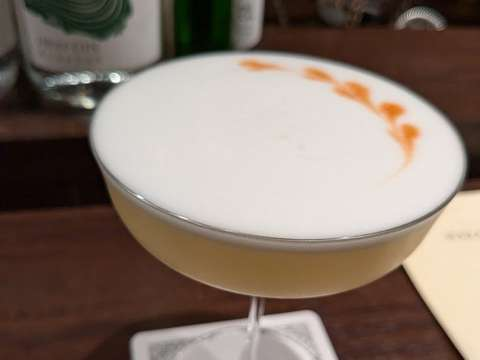

  <section class="hero" aria-labelledby="hero-name">
    

      PERSONAL WEBSITE · PHILOSOPHY / REHABILITATION / NOTES
      <h1 id="hero-name">宇野 佑</h1>
      
Tasuku Uno

      
言語聴覚士。日曜哲学者。

      
バーやカクテルの哲学・倫理学、言語聴覚療法、モクテルをめぐる研究と関心。ここには研究業績、読書ノート、関連資料、日々の記録をまとめています。

      
Emailtasukuuno926[at]gmail.com

    

    <figure class="hero-photo"></figure>
  </section>
  <section class="home-map" aria-label="サイトの案内">
    

      <h2 class="map-title">EXPLORE / このサイトにあるもの</h2>
      <nav class="map-list" aria-label="コンテンツ一覧"><a class="map-link" href="../site/research.qmd">01研究・発表哲学・倫理学、言語聴覚療法、研究業績の一覧↗</a><a class="map-link" href="../posts/index.qmd">02雑記・読書ノート哲学の論文ノート、音楽や批評についての文章↗</a><a class="map-link" href="../source/index.qmd">03モクテル資料集嚥下・味・物性・調理技術などの関連資料↗</a><a class="map-link" href="../diary/index.qmd">04日記日々の記録を月ごとに↗</a><a class="map-link" href="../log/index.qmd">05読んだり見たり作ったり本、映画、音楽、料理、制作の記録↗</a></nav>
    

    <aside class="features" aria-labelledby="selected-heading">
      <h2 class="map-title" id="selected-heading">SELECTED READING / まず読むなら</h2>
      
<a class="feature-item" href="../posts/schramme-2023-health.qmd">Note · Philosophy of healthSchrammeの健康概念についてのノート ↗</a><a class="feature-item" href="../posts/prince-kiss.qmd">Essay · Music / InterpretationPrinceの「Kiss」の歌詞は価値観の提示か、それともストーリーか？ ↗</a><a class="feature-item" href="../source/mocktail.qmd">Resources · Mocktails嚥下と飲料・モクテル研究につながる資料 ↗</a>

      <a class="feature-all" href="../posts/index.qmd">文章の一覧を見る →</a>
    </aside>
  </section>
  <footer class="home-footer">
    
<a href="https://researchmap.jp/uno.tasuku">researchmap ↗</a>tasukuuno926[at]gmail.com

    © Tasuku Uno
  </footer>

